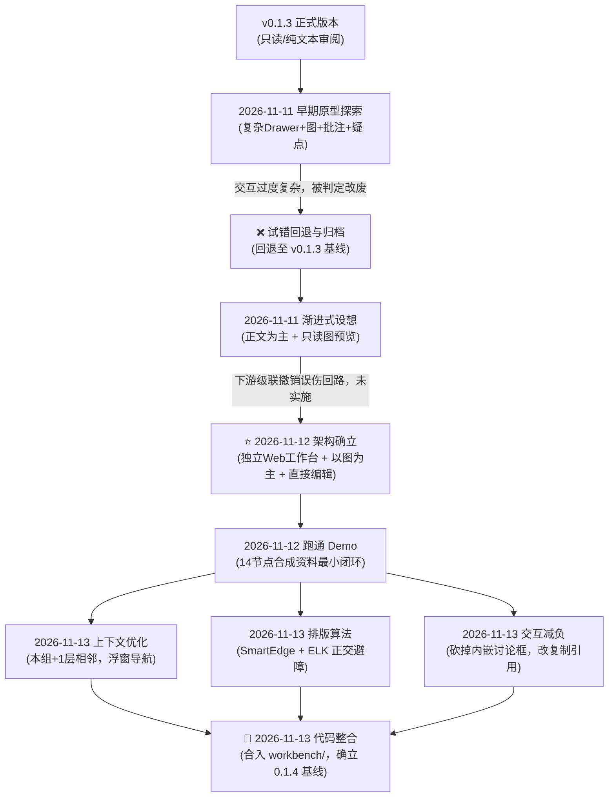

# 6ak Process Review 研发资产与技术演进索引

本目录记录了从 **v0.1.3 发布后（2026-11-10）** 到 **0.1.4 独立流程工作台基线确立（2026-11-13）** 的完整技术方案演进、试错复盘、算法选型与整合记录。

---

## 一、技术决策与演进脉络

---

## 二、文档全景速查表

### 1. 0.1.4 生效中的核心架构与实现规范（[research/v0.1.4/](research/v0.1.4/)）

当前正在生效的架构蓝图、算法实现、界面规范与代码整合记录：

| 编号与文档 | 日期 | 状态定位 | 核心决策与解决问题 |
| :--- | :--- | :--- | :--- |
| [01-architecture-plan-20261112.md](research/v0.1.4/01-architecture-plan-20261112.md) | 11-12 | ⭐️ **生效中核心架构蓝图** | 确立本地 Web 工作台、以流程图为主工作区、节点与出口直接编辑保存（无需等 LLM）、双轨事务与并发保护。 |
| [02-ui-context-layout-20261113.md](research/v0.1.4/02-ui-context-layout-20261113.md) | 11-13 | ✅ **已实现 / 界面规范** | 确立“本组 + 1层直接相邻”（5+2）上下文阅读范围；左侧导航改为半透明悬浮窗；编辑抽屉自适应紧凑化。 |
| [03-routing-and-elk-layout-20261113.md](research/v0.1.4/03-routing-and-elk-layout-20261113.md) | 11-13 | ✅ **已实现 / 算法规范** | 引入 `@tisoap/react-flow-smart-edge` 与 `elkjs` 正交连线算法；支持固定节点（图钉）与避障重算、单组独立排版与撤销。 |
| [04-feedback-and-refactor-20261113.md](research/v0.1.4/04-feedback-and-refactor-20261113.md) | 11-13 | ✅ **已实现 / 交互重塑** | 全局改浅色；**彻底砍掉网页内嵌讨论框，改为“复制引用”回 Agent App**；将演示数据切换为真实电商知识库（37节点）。 |
| [05-integration-baseline-20261113.md](research/v0.1.4/05-integration-baseline-20261113.md) | 11-13 | 🏁 **当前代码基座说明** | 将 `local-workbench-demo` 前端和本地服务合入当前仓库 `workbench/`，确立 `0.1.4-dev.0` 开发基线，完成 136 项回归测试。 |
| [06-demo-milestone-20261112.md](research/v0.1.4/06-demo-milestone-20261112.md) | 11-12 | 📌 **阶段里程碑记录** | 记录在独立 worktree 中基于 14 节点合成数据首次跑通 4313 端口工作台的最小可行闭环。 |

---

### 2. 历史试错复盘与被替代的探索稿（[research/archive/](research/archive/)）

记录了被推翻的交互路线与失败原因，**避免未来重复踩坑**：

| 文档 | 日期 | 状态定位 | 为什么失败 / 被谁替代 |
| :--- | :--- | :--- | :--- |
| [20261111-prototype-retrospective.md](research/archive/20261111-prototype-retrospective.md) | 11-11 | ❌ **试错失败 / 已归档** | **早期原型改废复盘**：试图把图、正文、批注、手动编辑、疑点、确认和版本保护同时塞进多层 Drawer，导致认知负担极重，用户判定“改废”。代码封存至 `codex/archive-process-review-prototype-20261111`，全量回退。 |
| [20261111-progressive-graph-proposal.md](research/archive/20261111-progressive-graph-proposal.md) | 11-11 | ⚠️ **过渡设想 / 已被替代** | 设想“正文为主、图只读、确认一部分出现一部分、撤销时沿下游全部撤销”。分析发现该级联规则在回路和跨组连接中会严重误伤独立审阅结果，未落地，已被 11-12 独立工作台替代。 |
| [20261111-progressive-graph-plan.md](research/archive/20261111-progressive-graph-plan.md) | 11-11 | ⚠️ **过渡计划 / 已被替代** | 试图在 v0.1.3 正文审阅页内嵌入只读图的修改计划，已被 11-12 的“以图为主、独立工作台、直接编辑保存”方案整体推翻替代。 |

---

## 三、关键避免事项（Avoidance Checklist）

结合历史探索的失败教训，后续 0.1.4 迭代中**严禁引入**以下退化设计：
1. **禁止再造网页内内嵌聊天/讨论框**：网页只负责“直接编辑保存”和“生成带精确版本上下文的引用”；讨论与 LLM 交互一律在 Agent App 主对话进行（见 11-13 反馈记录）。
2. **禁止图上自动截断长句充当摘要**：所有图卡标题必须来自模型节点真实标题，分支条件必须可完整阅读，不能仅靠 hover 悬停提示（见 11-11 复盘与 11-12 架构方案）。
3. **禁止把“整理分组”自动包装为严格串行业务阶段**：分组只是阅读视图边界，不能强制加全局箭头或按顺序推断业务时序（见 11-13 上下文方案）。
4. **禁止把确认状态做成级联撤销**：业务流程存在回路、多入口和关联数据边，撤销某一处确认不得自动取消下游节点（见 11-11 设想分析）。
